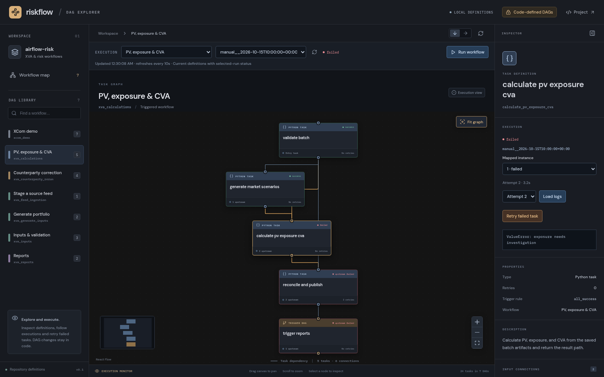

# React Flow DAG explorer

A visual workflow explorer and execution monitor using **React Flow**, an **ImNodes-inspired dark canvas**,
and **FastAPI**. It displays the actual DAG definitions in this checkout.
DAG definitions remain editable only through Python code. The existing Streamlit
application remains available separately.


## Start the demo

Use the project's Python environment with Airflow 3.3.2 installed, plus Node.js
20.19 or newer (Node 24 is recommended). From the repository root:

```bash
source .venv/bin/activate
python -m pip install -e '.[graph]'

npm --prefix web/dag-viewer ci
npm --prefix web/dag-viewer run build

python -m uvicorn risk_pipeline.graph_demo.api:app --host 127.0.0.1 --port 8001
```

Open **http://localhost:8001**. FastAPI serves the API and built frontend together;
there is no second frontend process to configure. Definition browsing works
without a running Airflow API or PostgreSQL. Execution controls require your
running Airflow scheduler, API server, and the services used by your DAGs.

If your terminal already uses `AIRFLOW_HOME`, keep that setting. Use the same
virtual environment for `python -m pip` and `python -m uvicorn`. Set
`XVA_PROJECT_ROOT` if the package is installed outside the checkout you want to
inspect; the viewer reads its `dags/` directory and serves its frontend build.

## Explore the visuals

- **Workflow map:** all local DAGs, with dashed connections for their explicit
  `TriggerDagRunOperator` links. Independent workflows remain unconnected.
- **DAG library:** select any workflow to display its tasks and dependencies.
  Search by name or DAG ID.
- **Inspector:** click a node to see its definition, dependencies, retries,
  schedule, and source file. Follow a trigger's target to the connected DAG.
- **Navigation:** double-click a workflow to open its tasks; pan, zoom, use the
  minimap, or fit the graph. Task layouts can be vertical or horizontal.




Task nodes have connection pins and selection highlights inspired by ImNodes.
The workflow map uses muted colours to distinguish input, calculation, reporting,
and correction workflows. The task view distinguishes Python tasks from DAG
triggers. Fonts are bundled in the frontend build, without an external font service.

The diagram comes from parsing the repository's Python DAG definitions with
Airflow's `DagBag`; task lists and dependency edges are not a mock portfolio or a
hardcoded task graph. **Reload definitions** reads the files again. The overview
arranges the four main XVA stages first and places independent/correction DAGs
below them; additional local DAGs are included automatically.

## Connect execution controls

The FastAPI server uses the same configuration as the Streamlit control panel:

```bash
export XVA_AIRFLOW_URL=http://localhost:8080
export XVA_AIRFLOW_USERNAME=your-airflow-user
# Set XVA_AIRFLOW_PASSWORD securely in this server's environment.
# Alternatively, set XVA_AIRFLOW_TOKEN for an existing Airflow bearer token.
python -m uvicorn risk_pipeline.graph_demo.api:app --host 127.0.0.1 --port 8001
```

Credentials stay on the Python server. Password-based authentication renews expired
JWTs automatically. The account needs permission to read DAGs, runs, task instances,
XCom handoffs and logs, create runs, and clear task instances. No results-database
connection is needed by this viewer. Keep the viewer bound to localhost; this version
uses a shared server-side Airflow identity and has no separate browser login.

- **Run workflow:** choose an existing DAG and review its JSON run configuration.
  The generator defaults to 2,000 counterparties and 10,000 trades. Paths refer to
  files accessible to Airflow workers. For corrections, supply a seven-character
  `counterparty_code` and updated feed paths or feed IDs in `feeds`.
- **Direct calculations/reports:** reuse the upstream handoff's `batch_id` and
  `snapshot_path` or `publication_path`; the launch form validates required fields.
  Running the generator starts the normal connected XVA pipeline.
- **Paused workflows:** enable the DAG and its downstream DAGs in Airflow first.
  The viewer refuses partial launches and never silently enables daily schedules.
- **Execution selectors:** choose a root workflow and run. Status refreshes every
  10 seconds and follows exact child run IDs from frozen XCom handoffs. Navigating
  the graph retains that execution; unrelated DAGs are marked outside execution.
- **Task inspector:** select a task, choose its mapped instance/attempt if applicable,
  and click **Load logs**. Logs load on request; click again to refresh them.
- **Retry failed task:** review and confirm clearing the failed task and downstream
  tasks **within its original DAG run**, preserving the original configuration and
  DAG version. The server checks it is still failed. Linked DAG runs are not cleared;
  select an independently failed child task to retry it. Corrected input data should
  use a new counterparty correction run rather than changing the original run.
- **Timeouts:** retry the same launch form to recover the same request ID without
  duplicating a run. If you close the form after an uncertain outcome, check recent
  runs before preparing a new request.

Node badges and borders show success, running, failed, queued and other Airflow
states. If refresh fails, the canvas marks status unavailable instead of retaining
stale success colours. The graph displays **current code definitions**: tasks absent
from a historical run are labelled accordingly, and extra historical task instances
produce a warning. Use Airflow for viewing an older DAG definition.

Nodes cannot be moved, added, removed or connected. Definition endpoints remain
GET-only; the only write operations launch an existing DAG or retry a failed task.
Browsing definitions does not contact Airflow or change any runs.

## Development and checks

For frontend hot reload, leave FastAPI running on port 8001 and run:

```bash
npm --prefix web/dag-viewer run dev
```

Open **http://localhost:5173**; Vite proxies `/api` to FastAPI. Python changes can
be reloaded by starting uvicorn with `--reload`.

```bash
python -m pytest tests/test_graph_demo.py tests/test_graph_execution.py tests/control_panel -q
cd web/dag-viewer
npx playwright install chromium
npm run build
npm run test:e2e
```

The browser tests start their own backend on port 8001, so stop a development
server on that port first. They verify real dependencies, node inspection,
workflow navigation, immutable graph interactions, launches, status overlays, logs,
confirmed retries, and stale-status handling. Execution browser tests mock Airflow
responses and never launch your jobs. To use an existing Chromium
binary, set `PLAYWRIGHT_CHROMIUM_EXECUTABLE_PATH`. To use another Python executable
for the test server, set `XVA_DEMO_PYTHON` to its absolute path.
