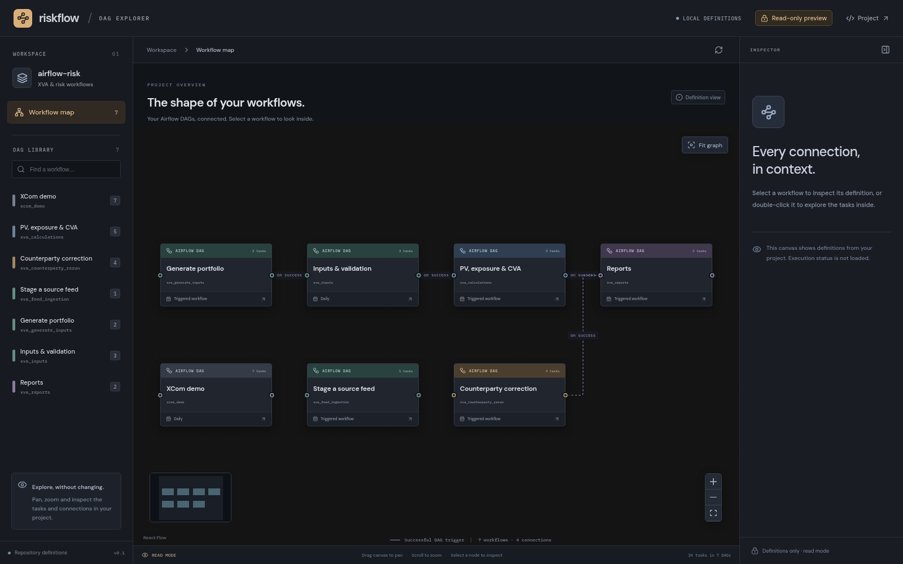
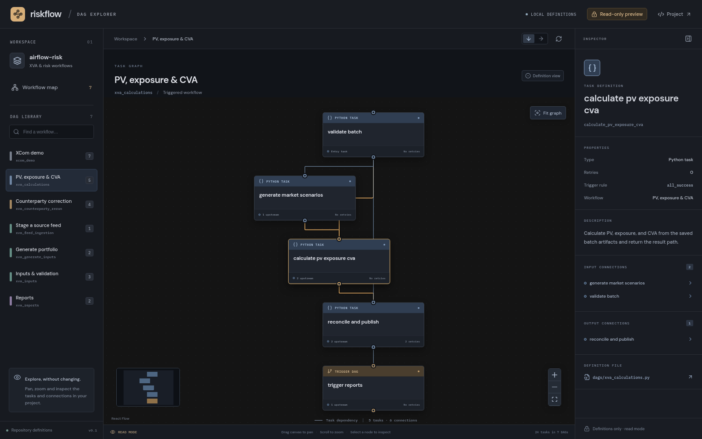

# React Flow DAG explorer

A read-only visual demo using **React Flow**, an **ImNodes-inspired dark canvas**,
and **FastAPI**. It displays the actual DAG definitions in this checkout.
The existing Streamlit application remains available separately.



## Start the demo

Use the project's Python environment with Airflow 3.3.2 installed, plus Node.js
20.19 or newer (Node 24 is recommended). From the repository root:

```bash
source .venv/bin/activate
python -m pip install -e '.[graph]'

npm --prefix web/dag-viewer ci
npm --prefix web/dag-viewer run build

python -m uvicorn risk_pipeline.graph_demo.api:app --host 127.0.0.1 --port 8001
```

Open **http://localhost:8001**. FastAPI serves the API and built frontend together;
there is no second frontend process to configure. Airflow's scheduler/API server
and PostgreSQL do not need to be running for this definition-only demo.

If your terminal already uses `AIRFLOW_HOME`, keep that setting. Use the same
virtual environment for `python -m pip` and `python -m uvicorn`. Set
`XVA_PROJECT_ROOT` if the package is installed outside the checkout you want to
inspect; the viewer reads its `dags/` directory and serves its frontend build.

## Explore the visuals

- **Workflow map:** all local DAGs, with dashed connections for their explicit
  `TriggerDagRunOperator` links. Independent workflows remain unconnected.
- **DAG library:** select any workflow to display its tasks and dependencies.
  Search by name or DAG ID.
- **Inspector:** click a node to see its definition, dependencies, retries,
  schedule, and source file. Follow a trigger's target to the connected DAG.
- **Navigation:** double-click a workflow to open its tasks; pan, zoom, use the
  minimap, or fit the graph. Task layouts can be vertical or horizontal.



Task nodes have connection pins and selection highlights inspired by ImNodes.
The workflow map uses muted colours to distinguish input, calculation, reporting,
and correction workflows. The task view distinguishes Python tasks from DAG
triggers. Fonts are bundled in the frontend build, without an external font service.

The diagram comes from parsing the repository's Python DAG definitions with
Airflow's `DagBag`; task lists and dependency edges are not a mock portfolio or a
hardcoded task graph. **Reload definitions** reads the files again. The overview
arranges the four main XVA stages first and places independent/correction DAGs
below them; additional local DAGs are included automatically.

This is **definition reading mode**, not an execution monitor. Node colours are
categories, not run states. Nodes cannot be moved, added, removed, or connected;
there are no launch, publish, retry, or save actions. The backend provides only
GET endpoints and does not execute task bodies. The existing Streamlit control
panel handles live operations until a future version adds them here.

## Development and checks

For frontend hot reload, leave FastAPI running on port 8001 and run:

```bash
npm --prefix web/dag-viewer run dev
```

Open **http://localhost:5173**; Vite proxies `/api` to FastAPI. Python changes can
be reloaded by starting uvicorn with `--reload`.

```bash
python -m pytest tests/test_graph_demo.py -q
cd web/dag-viewer
npx playwright install chromium
npm run build
npm run test:e2e
```

The browser tests start their own backend on port 8001, so stop a development
server on that port first. They verify real dependencies, node inspection,
workflow navigation, and read-only interactions. To use an existing Chromium
binary, set `PLAYWRIGHT_CHROMIUM_EXECUTABLE_PATH`. To use another Python executable
for the test server, set `XVA_DEMO_PYTHON` to its absolute path.
